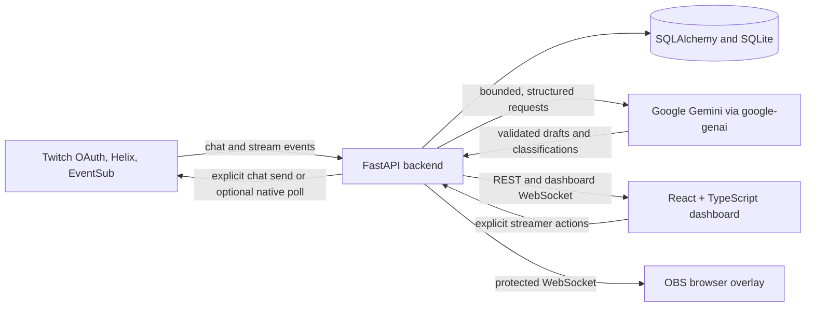

# StreamPilot AI

StreamPilot AI is a Twitch audience interaction co-pilot for gaming streamers: it turns live chat into a prioritized Smart Queue, groups differently phrased questions, surfaces possible audience polls, drafts grounded replies, and provides post-stream insights—while leaving consequential decisions in the streamer's hands.

## The problem

Fast-moving streams make it hard to notice repeated questions and useful audience signals among ordinary chat, spam, and competing preferences. A streamer can miss a question, repeat the same answer, or interrupt gameplay to interpret the conversation. StreamPilot places recent chat beside a compact, explainable queue so the streamer can decide what to address.

## Features

- Twitch OAuth and EventSub chat intake, including supported message delete and chat-clear notifications.
- Smart Interaction Queue with deterministic English/Hinglish question detection, same-session fuzzy grouping, optional batched Gemini grouping, viewer counts, priorities, filters, and answer/snooze/dismiss actions.
- On-demand Gemini challenge suggestions and reply drafts. Stream facts can ground a reply; drafts remain editable and are sent only after an explicit streamer action.
- Audience poll suggestions from competing chat preferences. The existing StreamPilot `!vote N` challenge flow remains available. Optional native Twitch polls are implemented behind an opt-in setting and require Affiliate/Partner eligibility and reauthorization.
- Flag-only moderation suggestions, live community statistics, and cached post-stream recaps.
- Protected OBS overlay for audience votes and an optional streamer-featured question.
- Optional development replay, a small deterministic queue evaluation set, and a manual integration health check.

### Screenshots

Replace these placeholders with screenshots captured from a safe demo account. Do not include credentials, session cookies, private overlay URLs, or viewer data that should not be public.


## Architecture



## Run locally from a clean machine

### Prerequisites

- Git.
- Python 3.12 or newer.
- Node.js 20 LTS or newer with npm.
- A Gemini API key for live Gemini calls.
- A Twitch Developer application and a Twitch account for live Twitch integration. The app can be explored locally without provider credentials, but live integrations will not be available.

### Register a Twitch application

1. Create an application in the [Twitch Developer Console](https://dev.twitch.tv/console/apps).
2. For direct local development, register this exact OAuth redirect URI: `http://localhost:8000/auth/twitch/callback`.
3. Copy the Twitch Client ID and Client Secret into the backend environment file only. The app's default scopes are `user:read:chat user:write:chat`. Native poll management is optional, disabled by default, and requires the streamer to opt in and reauthorize.

### Configure environment variables

From the repository root, create the backend's local environment file:

```powershell
Copy-Item backend/.env.example backend/.env
```

Edit `backend/.env` and set:

| Variable | Purpose |
|---|---|
| `APP_ENV` | Use `development` locally. The replay tool refuses `production`. |
| `APP_SECRET_KEY` | Unique random secret, at least 32 characters; encrypts Twitch tokens and protects session-derived values. Generate locally with `python -c "import secrets; print(secrets.token_urlsafe(48))"`. Keep it stable after authorizing Twitch. |
| `DATABASE_URL` | Defaults to local SQLite at `./streampilot.db` when the backend runs from `backend/`. |
| `GEMINI_API_KEY` | Gemini API key; keep it backend-only. |
| `GEMINI_MODEL` | Model name available to your Gemini project; the current example defaults to `gemini-3.5-flash-lite`. |
| `TWITCH_CLIENT_ID` / `TWITCH_CLIENT_SECRET` | Credentials from your Twitch application. |
| `TWITCH_REDIRECT_URI` | Must exactly match the Twitch application callback; use the local URI above. |
| `TWITCH_SCOPES` | Defaults to `user:read:chat user:write:chat`; do not add optional poll scope unless enabling native polls. |
| `DEMO_MODE` | Defaults to `false`. Set `true` only for a local UI preview without Twitch authorization; never use it in production. |

Keep `.env` files, keys, tokens, and local databases out of source control. Changing `APP_SECRET_KEY` can make previously encrypted Twitch tokens unreadable.

### Start the backend

In PowerShell:

```powershell
cd backend
python -m venv .venv
.\.venv\Scripts\Activate.ps1
python -m pip install --upgrade pip
python -m pip install -e ".[dev]"
uvicorn app.main:app --reload --port 8000
```

The API and interactive Swagger page are at `http://localhost:8000` and `http://localhost:8000/docs`.

### Start the frontend

In a second terminal at the repository root:

```powershell
cd frontend
npm ci
npm run dev
```

Open the Vite URL shown in the terminal (normally `http://localhost:5173`). For real Twitch data, choose **Connect Twitch** and authorize the broadcaster. An accepted subscription or configured credential alone is not proof of message delivery; verify a harmless chat message actually appears.

### Docker Compose option

Install Docker Desktop with Docker Compose, create and configure `backend/.env` as above, and register `http://localhost:8080/auth/twitch/callback` as the Twitch redirect URI. The Compose file keeps the backend behind Nginx, sets `DEMO_MODE=false`, and stores SQLite data in a named volume.

```powershell
docker compose up --build
```

Open `http://localhost:8080`. To stop the services, run `docker compose down`; the named database volume is retained. The current development environment did not have Docker available, so a clean Compose build has not been verified here.

### Add the OBS browser source

1. In StreamPilot, open **Overlay Setup** and choose **Generate overlay link**.
2. In OBS, add a **Browser Source** and paste that private URL. Use your stream canvas dimensions (for example, 1920 × 1080).
3. Confirm the overlay connects, then test a vote with a controlled channel before recording.

The URL contains a bearer token. Keep it private, do not commit it, and do not show it in a recording. The optional Question of the Moment widget only appears after the streamer features a queue card.

## Safety design

- A Gemini suggestion is a draft. The streamer must review and approve a challenge before launch; poll suggestions also require streamer approval. Native Twitch poll creation is a separate explicit action.
- Gemini reply text is only sent after the streamer explicitly chooses **Send to chat**. Suggestions are bounded, schema-validated, and grounded in optional streamer-provided facts; unsupported facts use a safe holding reply.
- Viewer chat is untrusted input, including text that looks like instructions. It is bounded, framed as data in model prompts, and model output is validated. No model tools are provided for queue grouping.
- Moderation is flag-only. StreamPilot does not automatically ban, time out, or delete messages.
- Queue grouping falls back to deterministic detection when Gemini is missing, invalid, slow, or unavailable. Challenge suggestions use a labeled fallback; recap generation has a safe local fallback. AI failure does not approve or launch an action.
- Secrets stay on the backend. Twitch tokens are encrypted at rest; dashboard APIs are authenticated and scoped to the broadcaster; overlay access uses a private token.

## Limitations and known issues

- Automated provider tests use mocks. This repository does not claim a verified live Twitch/EventSub/Gemini end-to-end path; confirm actual chat delivery, moderation events, votes, overlay behavior, timer closure, and any chat announcement on a controlled channel.
- Optional native Twitch polls are implemented but only available to Affiliate or Partner broadcasters with the opt-in scope. Live eligibility and creation remain to be verified.
- The Smart Queue evaluation is a small curated sample, not a representative or held-out Twitch corpus. See [docs/EVALUATION.md](docs/EVALUATION.md).
- SQLite, rate limiting, workers, token-refresh coordination, and WebSocket registries target a single backend process. Horizontal scaling requires shared coordination and a production-grade database.
- No hosted deployment or public video has been performed by this repository workflow. The app does not control games or execute arbitrary game commands.
- The optional health check makes real provider requests and rotates the stored Twitch refresh token. The replay script writes synthetic rows to the local database and can call the configured Gemini model; neither is required for the live-channel demo.

## Roadmap

- Improve rehearsal evidence and live verification for the already implemented, opt-in native Twitch poll path, including eligibility and recovery UX.
- Add multi-platform chat ingestion while retaining broadcaster/session boundaries and explicit streamer control.
- Expand analytics with more longitudinal, cross-session insights and stronger evaluation data.
- Validate backup, migration, deployment, and multi-instance coordination before a hosted production release.

## Project documentation

- [Demo video script](docs/DEMO_SCRIPT.md)
- [Submission package](docs/SUBMISSION.md)
- [Codex usage log](docs/CODEX_USAGE.md)
- [API reference](docs/API_REFERENCE.md)
- [Technical design](docs/TECHNICAL_DESIGN_DOCUMENT.md)
- [Test cases](docs/TEST_CASES.md)
- [Evaluation results](docs/EVALUATION.md)
- [Progress and verification log](docs/PROGRESS.md)

License: [MIT](LICENSE).
