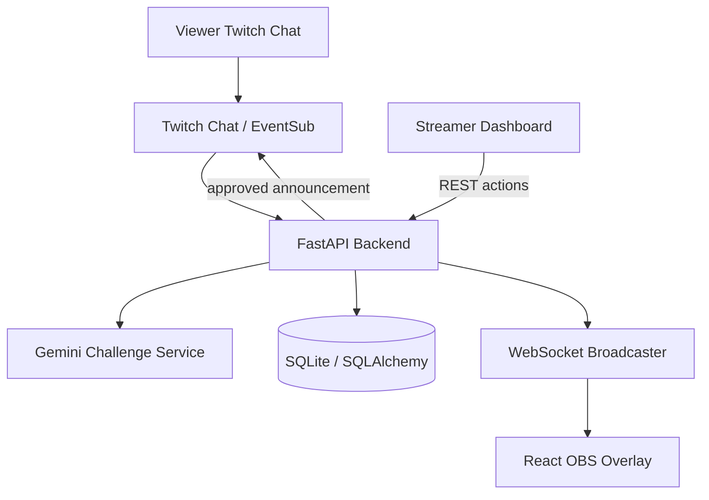

# Architecture Overview

Trust boundaries:
- Twitch chat is external and untrusted.
- Gemini output is untrusted until schema validation succeeds.
- Only an authenticated streamer can approve/launch.
- Overlay receives display-safe data only.
- Secrets remain in backend configuration.

The local Vite server proxies `/api`, `/auth`, and `/ws` to FastAPI. The Compose frontend uses Nginx for the same proxy paths, while FastAPI remains private to the Compose network. SQLite lives in the named `streampilot-data` volume. Gemini and Twitch code paths are present, but real-service verification is still pending.
